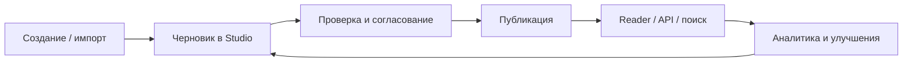
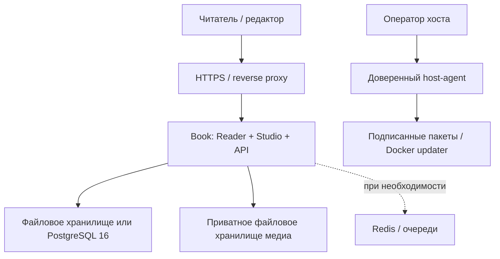

# CajeerEngine Book Edition

**Документация, знания и API — в одной самостоятельной платформе.**

---

> [!NOTE]
> **Версия исходников ≠ опубликованный релиз.** В этом дереве указан Book `1.2.0`, PostgreSQL schema `7` и встроенное ядро `2.1.0`. Установка в production допускается только из независимо проверенного **подписанного релиза** после соответствующих проверок. Архив изменённых файлов и ZIP исходников сами по себе таким релизом не являются.

**CajeerEngineBook** — self-hosted система для создания, согласования, публикации и сопровождения документации. Она объединяет редактор Markdown, публичный Reader, рабочие пространства и права доступа, API-справочники, инструменты импорта и корпоративную эксплуатацию.

[**Начать знакомство →**](docs/product/README.md) · [Возможности](docs/product/features.md) · [Архитектура](docs/product/architecture.md) · [Развёртывание](docs/product/deployment.md) · [Релизы](docs/releases/README.md)

---

## От идеи до опубликованной документации

| Для авторов и редакторов | Для разработчиков | Для администраторов |
| --- | --- | --- |
| Markdown и визуальное редактирование, блоки, медиа и версии | OpenAPI, примеры SDK, API Playground, GitHub/GitLab Sync | Организации, RBAC, OIDC, аудит, резервирование и контролируемые обновления |
| Черновики, ревью и публикация | Импорт существующих баз знаний | PostgreSQL, Redis, мониторинг, восстановление |

### Что доступно в проекте

- **Контент:** дерево страниц, версионирование, локализации, история редакций, вложения, интерактивные блоки и Mermaid.
- **Командная работа:** организации, рабочие пространства, роли, приватные разделы, согласование изменений и журнал действий.
- **Документация для разработчиков:** OpenAPI, playground, SDK-примеры, Git Sync, CI/CD-публикация и статический экспорт.
- **Переезд с других платформ:** импорт Markdown и поддерживаемых структур GitBook, Docusaurus, Mintlify, ReadMe и Fumadocs. Импортированные материалы требуют проверки и отдельной публикации.
- **Поиск и обратная связь:** полнотекстовый и опциональный гибридный поиск, аналитика с учётом согласия, опциональный AI-помощник и чат по документации.
- **Эксплуатация:** Docker Compose, SQL-хранилище, Redis, наблюдаемость, PITR, подписанные артефакты и обновление через доверенный host-agent.

Подробности и границы поддержки: [матрица возможностей](docs/product/features.md).

## Выберите сценарий

| Задача | Куда перейти |
| --- | --- |
| Ознакомиться с продуктом и рабочими процессами | [Обзор](docs/product/README.md) · [Сценарии](docs/product/workflows.md) |
| Развернуть новую установку | [Варианты установки](docs/product/deployment.md) · [операторское руководство](docs/admin/operations.md) |
| Понять разграничение доступа и работу с данными | [Безопасность и данные](docs/product/security.md) |
| Узнать, что появилось в версиях | [Центр релизов](docs/releases/README.md) · [полный технический журнал](CHANGELOG.md) |
| Настроить production-эксплуатацию | [Справочник администратора](docs/admin/README.md) |
| Проверить выпуск и обновление `1.2.0` | [Обзор релиза](docs/releases/v1.2.0.md) · [процедура допуска](docs/admin/release-120.md) |

## Модель развёртывания

Минимальный вариант — один узел и приватный постоянный том. Для SQL-режима используются PostgreSQL 16 и то же приватное хранилище медиа. Репликация приложения требует отдельной инфраструктуры и проверки готовности; Redis Sentinel и восстановление базы данных эксплуатирует оператор. Точные условия см. в [руководстве по развёртыванию](docs/product/deployment.md).

## Выпуски и совместимость

| Параметр | Значение в этом дереве |
| --- | --- |
| Версия приложения | `1.2.0` |
| Версия встроенного ядра | `2.1.0` — **не** полная CMS CajeerEngine |
| PostgreSQL schema | `7` |
| Ключевое изменение 1.2.0 | Защита и проверка существующего пути подписанных обновлений |
| Публикация официального ZIP / OCI | Проверяется отдельно по подписанным артефактам и protected CI |

> [!IMPORTANT]
> Веб-панель обновлений не заменяет допуск оператора. `Fetch` и `Preflight` не активируют выпуск; `Apply`, восстановление и откат требуют ограниченного окна обслуживания и проверки резервной копии. Автоматическое применение по расписанию не предусмотрено.

**Исходный код:** [GitHub](https://github.com/CajeerTeam/CajeerEngineBook) · **Лицензия:** [Apache-2.0](LICENSE) · **Примечания к бренду:** [TRADEMARKS.md](TRADEMARKS.md)

Исторический README

Предыдущий расширенный README с инструкциями старых версий сохранён в [архиве документации](docs/archive/README-legacy.en.md). Его команды привязаны к конкретным версиям и не заменяют [актуальное руководство администратора](docs/admin/README.md).

© 2026 SkiF4er · Cajeer Team · сведения о правообладателях и участниках: [NOTICE](NOTICE).
