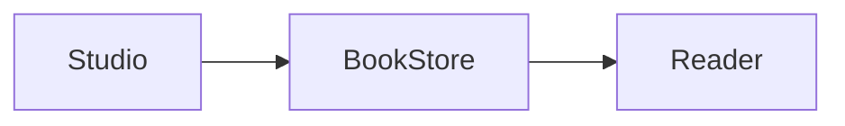

# CajeerEngine Book Edition

Self-hosted documentation and knowledge-base platform based on CajeerEngine 1.3.0 (source snapshot `8edfc810c0fa690118bb3a599b7e349e0847420c`). Book 0.2.1 is a separate, focused edition: it reuses the upstream CJR template engine, ServiceContainer and durable filesystem primitives, not the full CMS kernel or its database. Apache-2.0; see LICENSE and NOTICE.

## Features

- Individual user accounts, password sign-in, personal profiles, server-side revocable sessions, operator recovery tokens and installation-owner user management. Studio is owner-only until organization/workspace roles are implemented.

- Multiple books and versions, hierarchical URL paths, section navigation, page order, previous/next links, headings table of contents, responsive layout and light/dark theme.
- Studio page tree: nested page/folder navigation, native drag-and-drop, keyboard/touch move form, slug rename, branch duplication, stable IDs and published redirects. Draft structure and public navigation are separate.
- Studio: visual block editing, Markdown source mode, server preview, autosave, create/edit/delete pages, explicit publishing and unpublishing, version cloning to drafts, optimistic revision checks.
- CommonMark 0.31.1 and GitHub-Flavored Markdown (GFM), powered by League CommonMark: nested lists, ATX/Setext headings, reference links, inline/fenced/indented code, blockquotes, tables, task lists, strikethrough, autolinks and images. Shared rendering in Reader and Studio with stable heading slugs and legacy anchors.
- Published-only search and JSON read API, health probes, authenticated JSON metadata export and complete media backup.
- Media library: drag-and-drop uploads, folders, search/filter, immutable files, SHA-256 deduplication, private previews, safe published access, thumbnails and full TAR backup/restore.
- Images and attachments: insert or upload directly in Studio, edit alternative text, captions, image width/alignment, replace media, insert download blocks, and open images at full size in Reader/Preview.
- Mermaid diagrams: standard fenced Markdown, live Studio preview, sandboxed Reader SVG, zoom/full screen, PNG export, source fallback and theme redraw. Block drag handles and keyboard reorder controls.
- Local file persistence with locking and atomic replacement, no SaaS, database, Node, CDN or external API required at runtime. Composer installs PHP dependencies at build/install time.

- Rich documentation components: six callout types, responsive card grids with links, icons and media; structured Visual editing, nested Markdown and shared preview.

## Start locally

Requirements: PHP 8.4.1+ with `mbstring`, `fileinfo`, `phar`, JSON, ctype, PCRE and sessions (GD with JPEG/PNG/WebP support is recommended and included in Docker); Composer 2 for dependency installation. Linux is the supported filesystem environment.

```sh
composer install --no-dev --prefer-dist --no-interaction
sh bin/install-mermaid.sh # Node 22/npm; install the local diagram library
# Read-only demo (Studio is disabled until configured)
php -d upload_max_filesize=20M -d post_max_size=24M -d memory_limit=256M -S 127.0.0.1:8080 -t public public/router.php
```

Open http://127.0.0.1:8080/ and `/login`. Public documentation is readable without initialization. To enable Studio on a fresh installation, initialize the owner from the trusted local CLI (run as the same OS user that owns the data directory):

```sh
export BOOK_DATA_DIR="$PWD/var"
export BOOK_SECURE_COOKIE=0 # local HTTP only; use 1 on HTTPS
read -rs -p 'Owner password (12–72 bytes): ' BOOK_PASSWORD; echo
printf '%s' "$BOOK_PASSWORD" | php bin/identity.php init admin admin@example.com 'Administrator'
unset BOOK_PASSWORD
php -d upload_max_filesize=20M -d post_max_size=24M -d memory_limit=256M -S 127.0.0.1:8080 -t public public/router.php
```

No default password, public registration or Basic Auth fallback. Sign in via `/login` and use `/account` to manage profile, password and sessions; `/account/users` is owner-only. Use HTTPS and `BOOK_SECURE_COOKIE=1` outside localhost. Secure cookies have the `__Host-` prefix, HttpOnly, SameSite=Strict and path `/`; do not use HTTP for real credentials. Reverse proxies should rate-limit `/login`, `/account/reset` and Studio; rate limiting inside the application uses `REMOTE_ADDR`, not client-supplied forwarded headers.

## Upgrade to 0.2.1 — Identity & Authentication

1. Stop writes and back up the complete `BOOK_DATA_DIR` before overlaying the release. Keep the existing `BOOK_ADMIN_HASH` only for the initial migration.
2. Rebuild the container or install existing locked dependencies and local Mermaid assets as before. Open `/login`, enter username `admin` and the previous password. Successful authentication atomically creates the owner with the existing password hash (rehashes if required). Failed login cannot initialize an owner. If the previous password is unavailable, run the trusted CLI `init` command before the first successful login instead. Existing passwords exceeding 72 bytes require CLI initialization/recovery rather than accepting bcrypt-truncated passwords.
3. In `/account` set the owner's email and change the password if needed. Remove `BOOK_ADMIN_HASH` from deployment configuration after initialization and recreate the container. Once an owner exists, that hash is never consulted to authenticate any account, even if left configured. Existing Basic Auth credentials and old PHP session cookies do not authorize Studio.
4. Create individual users under `/account/users`; ordinary users can sign in, manage their own profile and sessions, but cannot enter any Studio route. Owner is an installation-level bootstrap privilege, not yet an organization role. No organizations, private books, email verification, SMTP, public signup or RBAC beyond this owner gate in this release.
5. Verify `/health/ready`, public docs, Studio, account and backup. Content `books.json` schema and Markdown are unchanged; identity uses a separate schema-1 file under `BOOK_DATA_DIR/identity/identity.json` with a dedicated lock. This avoids including credentials in content backups. Do not remove that directory to reset a password.

### Identity and session policy

Usernames are case-insensitive ASCII (3–40 characters), email addresses unique case-insensitively (contact data, not login identifiers or verified recovery channels). Passwords are hashed with PHP `PASSWORD_DEFAULT`; new passwords must be 12–72 bytes. Sessions store only a SHA-256 digest of the random 256-bit bearer token; CSRF tokens are bound to each session. Login and reset forms use a separate strict, HttpOnly double-submit cookie. Session lifetime is seven days, idle expiry eight hours, with activity refreshed at most every five minutes; maximum ten sessions per account. Password change and recovery revoke all previous sessions and recovery tokens. Disabling a user revokes sessions immediately for subsequent requests; requests already authorized and executing may finish. Login limits: five failed attempts per account and 30 total attempts per source IP per 15-minute window (successful login clears the account counter, not the IP counter). Recovery and current-password verification have separate rate buckets. No trust in X-Forwarded-For; behind a reverse proxy, configure infrastructure rate limiting and consider the shared IP limit. Maximum 500 users, 4 MiB identity metadata. Account management cannot disable the only installation owner. Session expiry/denial stops Studio autosave; copy local Markdown, sign in again in another tab, then reload before retrying.

### Recover access and back up identity

Only a trusted operator with filesystem access may issue a recovery token. Tokens expire after 30 minutes, are single-use, are stored only as SHA-256 digests, and a new token invalidates the previous one. Pass the token securely to the user; enter it in `/account/reset` (not in a URL). Resetting the password revokes all existing sessions. Do not write tokens to public logs or send them over unencrypted channels.

```sh
# Run as the data directory owner, with BOOK_DATA_DIR set to the installation.
php bin/identity.php reset admin
php bin/identity.php backup /secure/backups/identity-0.2.1.json
# Restore only to an installation with no initialized identity state.
BOOK_DATA_DIR=/private/restored-book php bin/identity.php restore /secure/backups/identity-0.2.1.json
```

The identity backup is a mode-0600 JSON file containing user records and password hashes (sensitive). It excludes sessions, reset tokens and throttling state. It cannot overwrite an existing backup or initialized identity; stop the service, restore documentation TAR into a new data directory, restore the matching identity backup, fix ownership, then point the service at that directory. A content TAR or `/studio/export` remains a **content-only** export (pages, redirects and media; no credentials); for a complete installation backup take both during a maintenance window or copy the entire stopped volume. A raw volume snapshot may contain live session/token hashes; prefer the identity CLI backup when migrating. Do not restore the raw identity state to an internet-facing instance without revoking sessions. Rollback to 0.2.0 requires the old deployment hash and pre-upgrade backup: older code ignores identity users and permissions.

Docker fresh setup (the volume must be writable by `www-data`):

```sh
docker compose up -d --build
read -rs -p 'Owner password: ' BOOK_PASSWORD; echo
printf '%s' "$BOOK_PASSWORD" | docker compose exec -T -u www-data book php bin/identity.php init admin admin@example.com 'Administrator'
unset BOOK_PASSWORD
# Recovery (keep output private):
docker compose exec -T -u www-data book php bin/identity.php reset admin
```

### Tests

`php tests/identity.php` exercises the real durable identity store without Composer; `python3 tests/identity-http.py` exercises the real PHP application with independent cookie jars; `python3 tests/identity-browser.py` exercises interactive form login, management and revocation. The complete `composer test` and CI browser/Docker gates use the installed CommonMark and Mermaid dependencies and cookie-authenticated Studio. `BOOK_SECURE_COOKIE=0` is used only on disposable loopback tests.

## Upgrade to 0.2.0

Back up the entire `BOOK_DATA_DIR`, including `books.json` and any media files. Overlay the release files in the existing project directory (do not replace or delete `var/` or the persistent Docker volume). Install the locked dependencies using `composer install --no-dev --prefer-dist --no-interaction`, and install the local Mermaid asset with `sh bin/install-mermaid.sh`, or rebuild the Docker image with `docker compose up -d --build`. The JSON schema remains version 1; media metadata and page references are optional additive fields. Existing draft/published Markdown is not rewritten, and no database migration is required. Version 0.1.6 lazily adds stable page IDs, a published path, historical path reservations and optional relative-link context. Existing paths are not changed until a tree operation is committed. Do not roll back code to 0.1.5 after moving pages without restoring a pre-upgrade backup: older readers ignore the new published-path metadata. Recheck the public reader, Studio and health endpoint after the update.

### 0.2.0 release checks and upgrade from 0.1.9

This release preserves the schema-1 format and all existing Markdown sources. There is no destructive migration, but perform the following before exposing the upgraded service:

1. Stop authoring writes and back up the complete data directory, including the media blobs. Keep this copy outside `public/`. If the legacy JSON is larger than 32 MiB, use an offline filesystem copy rather than the TAR exporter.
2. Overlay the changed files; install the Composer lock and the pinned local Mermaid bundle (or rebuild the image). Keep the existing data volume and admin hash.
3. Run the data audit as the same operating-system user as the application (or with permissions to read the private data). For a Docker installation use `docker compose exec -u www-data book php bin/verify-data.php /var/lib/cajeerbook`.

```sh
php bin/verify-data.php /var/lib/cajeerbook
# If exit status is 2, review the reference mismatch count and, after backup:
php bin/verify-data.php /var/lib/cajeerbook --repair-media-references
php bin/verify-data.php /var/lib/cajeerbook
```

The audit validates page identities/paths, stored snapshots, actual media MIME/size/SHA-256 and AST-derived media references. Exit 0 means consistent, 2 means the stored reference index differs from the renderer, 1 means invalid data or a missing/corrupt file. The explicit repair recomputes only reference lists, in one locked atomic write, and invalidates affected page revisions. It does not publish a draft or rewrite Markdown. Previously, canonical media URLs with a query or fragment could fail to grant public access even when explicitly linked in published content. The repaired index makes those published links available and keeps draft-only references private. If an old link points to a nonexistent file, correct the link or restore the missing file; repair fails rather than silently dropping it.

New metadata snapshots are capped at **32 MiB** (matching the portable backup format). The 256 KiB per-page and 512 MiB binary-media quotas remain. Legacy oversized stores can still read and commit strictly size-reducing changes until below the cap; other writes are rejected before replacement. Readiness reports 503 for an oversized legacy store. Subdivide or remove content after an offline backup. Existing valid stores below the limit need no format conversion.

`/health/live` checks that the PHP application starts; `/health/ready` also checks the schema, page/path consistency, private storage writeability, media blob existence/size and required PHP/Mermaid assets. Docker uses the readiness endpoint for its health check. A failed readiness response is deliberately generic; see server logs for the cause. Dynamic responses use `Cache-Control: no-store` to avoid serving stale private/public state after unpublishing. The data directory and backup/restore destinations may not be inside or routed through `public/`. `BOOK_DATA_DIR` must not contain `..` segments. Apache disables symlink traversal in the document root. Continue to use HTTPS with `BOOK_SECURE_COOKIE=1`, rate limiting and a private data directory on production deployments.

Studio requests now have a 30-second deadline. On timeout the editor retains local Markdown and re-enables the controls; an uncertain save may have reached the server, so retry uses the existing revision check and a conflict must be resolved by copying/merging the local text. This is not a guarantee of automatic rollback after a network interruption.

### Release gate

Run on a disposable installation with PHP 8.4.1+, installed Composer dependencies, the pinned Mermaid assets, and Python 3.12:

```sh
composer validate --strict
composer audit --locked
composer test
python3 -m pip install playwright==1.57.0
python3 -m playwright install chromium
python3 tests/editor-network-browser.py
python3 tests/editor-browser.py
python3 tests/media-browser.py
python3 tests/images-browser.py
python3 tests/page-tree-browser.py
python3 tests/rich-blocks-browser.py
python3 tests/interactive-browser.py
python3 tests/mermaid-browser.py
```

`tests/release.php` builds one mixed document containing GFM, media, callouts, cards, nested tabs/accordion/steps, code tabs and Mermaid; verifies lossless editor segmentation, draft/public isolation, reference reindexing, tree publication and full backup/restore. `tests/release-http.py` verifies the actual HTTP application with an upload, rendering, publication, conflicts, redirects and TAR export. It creates a temporary store by default; `BOOK_TEST_URL` selects a disposable external instance (never use production data). CI runs the complete suite, then builds the Docker Compose deployment, executes the integration tests over Apache and verifies persistence after restarting the container. The narrow network-recovery browser test uses injected responses to test timeout handling without waiting 30 seconds; the full browser suites use real PHP and CommonMark. A passing CI and Docker release gate are required before declaring the build production-verified.

## Studio visual editor (0.1.6)

Open `/studio` and authenticate. Visual mode is enabled by default when JavaScript and the browser editing APIs are available; Markdown remains usable without JavaScript or if conversion fails. All assets are served locally, and there is no npm/CDN dependency.

- **Visual:** click a text block and type directly. Select text to apply bold, italic, strike, inline code, links or remove links. Use Block style for paragraphs, H1–H6 and quotations. Bullets/numbered lists, list indent/outdent, undo/redo and native editing shortcuts are supported. Add a paragraph, heading, quotation, list, divider or language-labelled code block using Add block. Remove a supported block with confirmation. Pasting inserts plain text rather than untrusted HTML.
- **Markdown:** edit the canonical source. Switch from Visual to Markdown to inspect the generated source, or use Copy Markdown. The server still stores Markdown, not HTML or an editor-specific JSON format.
- **Preview:** renders the current unsaved document on the server with the same CommonMark/GFM engine and URL policy as Reader. Existing page paths resolve relative links and images against their saved link context (the original path for moved/duplicated pages). No publishing is required to preview.
- **Save:** Save draft and Publish commit through the existing revision-checked store. Existing drafts autosave after approximately 1.8 seconds of idle editing; a new page needs an explicit first save or publication. Autosave never changes the published snapshot. Ctrl/Cmd+S saves the draft. A revision conflict stops writes, keeps the local text in Studio and asks the author to copy Markdown and reload/merge. Failed requests do not discard unsaved content. Refresh or leave Studio only after saving; the browser warns about unsaved changes.

Visual editing is intentionally source-preserving, not a wholesale HTML-to-Markdown rewrite: unchanged blocks and gaps (including reference definitions) retain their source. Modified supported blocks are serialized to canonical Markdown and separated safely; a modified reference link may become an equivalent inline link. Browsers normalize textarea line endings to LF. GFM tables and task lists are editable. Standalone images and local attachment blocks are editable. Mixed inline images, complex attachment labels, raw HTML, custom directives, nested code blocks and other unsupported AST structures remain visible but protected in Visual mode; edit them in Markdown mode. Tables that contain unsupported inline content, surplus source cells, or exceed visual limits are also protected. The editor uses native contenteditable/selection and browser editing commands; Chromium is the browser tested in CI. Markdown mode is the reliable fallback for unsupported browser commands or complex formatting. No new database migration is required.

### Page tree (0.1.6)

Open **Studio → Page tree** (`/studio/tree`). Choose a book/version. Existing slash-separated paths become a nested tree automatically, including implicit folder nodes for paths with no parent page. Expand or collapse child branches. The Reader sidebar and previous/next navigation use the published hierarchy in depth-first order; Studio uses drafts.

- Drag a branch's handle onto **Before**, **After**, **Inside**, or the version-root drop area. The entire branch (including private descendants) moves as one transaction. Alternatively use the Source branch, Destination and Position selects and click **Move branch**; these controls also work by keyboard, touch, or without JavaScript.
- Set **New slug** to rename a branch while moving it. To rename in place, choose before/after a sibling or inside its parent; a root can use the root position. The `+ Child` link opens the existing page editor with a child path prefilled. Page titles are edited in Studio, not used as route slugs.
- **Duplicate branch as drafts** copies all pages below the source, including draft content, with fresh stable IDs and no public snapshots. Choose a non-conflicting slug/destination. Existing media references are retained; immutable files are not duplicated.
- **Publish tree** applies draft paths and navigation order to pages that already have public snapshots. It never publishes draft-only pages or modified body/title/section content. An ordinary page Publish updates content at its current public path; new or previously unpublished pages publish at their draft path. Use Publish tree to apply reordered or moved published pages. Manual Order is also draft navigation order.
- Old published Reader and API URLs return HTTP 308 to the current public path, preserving query strings; redirects follow the stable identity directly after repeated moves. Unpublished or deleted pages do not redirect publicly. Old draft-only paths are reserved privately (and old Studio edit links redirect to their current draft). To avoid stale editor writes and hijacked links, retired paths cannot be reassigned to another page; the same identity may return to its own former path.
- Moves preserve Markdown and its relative-link context instead of rewriting the source. Reader and Preview resolve old internal page references to current published targets, including relative dot segments and fragment/query suffixes. For newly authored links in moved pages, use absolute `/docs/...` URLs if the intended destination differs from the original relative context. Raw source returned by the API is not rewritten. Version copies retain relevant published aliases and rebase relative-link context to the copied version; absolute cross-version links remain as authored.

A tree transaction checks the entire page revision token and runs under the same exclusive BookStore lock as page writes. Stale tabs receive HTTP 409 and must reload; invalid moves return HTTP 422, occupied paths return HTTP 409. Cycles, cross-book/version moves, collisions and unsafe paths are rejected. New paths/moves support up to 32 nested slug segments, 250 path bytes and the existing 1000-page quota. Historical redirects and retired draft paths are capped at 10,000 entries each. Existing legacy paths remain readable; folders are implicit and disappear when their last descendant is removed. No separate empty folder objects, cross-version drag/drop, collaborative editing, or external dependencies are introduced. Backups preserve tree identities, paths and aliases; restore validates the additional metadata.

### Tables & Rich Text

Choose **Table** in Add block or open an existing GFM table. Select a cell to edit its text, then use the main formatting toolbar for bold, italic, strike, inline code and links. Tab/Shift+Tab moves between cells; Enter is disabled because GFM cells are single-line. The first row is always the header. Add/delete body rows, move body rows up/down, add/delete/move columns and choose column alignment using the table controls. The header and final column cannot be deleted; remove the entire block instead. Undo/Redo and Ctrl/Cmd+Z support recent cell and structural edits (up to 25 bounded table snapshots per editing session). Structural edits are saved immediately in the local Markdown source; Save draft/Publish uses the existing revision checks.

Paste tab-separated spreadsheet data directly into a selected cell, or open **Import CSV / TSV**, choose the delimiter, paste text and select Insert data. The grid expands as needed and replaces the destination rectangle (existing cells outside the rectangle are untouched); quoted fields and doubled quotes are supported. Embedded newlines in fields become spaces. CSV uses comma delimiters; use TSV for spreadsheet clipboard data. Import is limited to 200 rows, 50 columns, 2500 total cells (including header) and the existing 256 KiB document limit. Unsupported or oversized existing tables are kept as source-protected blocks. GFM has no merged cells or multiline block content in cells. Structural edits normalize the changed table to GFM, including escaped pipe characters and alignment markers; unchanged tables retain their original Markdown.

Choose **Task list** in Add block or use Task list in the formatting toolbar to toggle a selected list item's task marker. Checkboxes in Studio update the Markdown `[x]` / `[ ]` state; Reader checkboxes remain disabled. The existing code-block language field accepts a language identifier. Reader and Preview highlight common lexical tokens locally for PHP, JavaScript/TypeScript, Python, Bash, SQL and JSON (plus common aliases); other languages and code over 64 KiB remain plain. Copy code copies the original text, not highlighted HTML. The highlighter is intentionally lightweight, not a full grammar parser.

## Markdown authoring and rendering

The application uses [League CommonMark](https://commonmark.thephpleague.com/) with the CommonMark core and GFM extensions. Markdown source stays unchanged in the store and API. Reader and Studio share the parser, and the preview resolves relative links and images against the document's saved link context, not the Studio route. The following works in Markdown mode and in Reader:

````markdown
## Installation

1. Install PHP and dependencies.
   - Enable `mbstring`.
2. Start the server.

- [x] Markdown engine
- [ ] Visual editor

| Package | Version |
| --- | ---: |
| PHP | 8.4 |

See [setup](getting-started#run-locally), https://example.org or ~~old~~ **new**.


```sh
composer install --no-dev
```
````

Heading IDs use lowercase Unicode text with runs of punctuation/whitespace replaced by hyphens; duplicates gain `-2`, `-3`, etc. Empty titles and reserved IDs receive a safe alternative. Existing `#section-N` links from 0.1.0 remain aliases for their original ATX headings. These legacy numbers follow the old parser's counter, including its handling of triple-backtick fences. Headings newly recognized by CommonMark, such as Setext headings, do not consume legacy numbers. Slugs are stable across renders and unrelated heading edits; editing a heading or reordering identical headings can change its slug. Use the TOC link for the actual anchor. GFM itself does not specify heading IDs.

Security policy: all raw HTML is escaped (including HTML otherwise allowed by GFM), executable MDX is disabled, unsafe URL schemes and protocol-relative URLs are rejected, `mailto:` is allowed only for links, and HTTP(S)/same-origin paths are allowed for links and images. Unsafe images render as plain alt text; unsafe links are inert. Data URLs are disabled. External images are fetched by the reader's browser, not the PHP server; they may disclose the reader's IP address to the image host, so use trusted or local images. HTTPS pages may block insecure HTTP images. No upload manager is included in this release.

The parser limits Markdown to valid UTF-8 and 256 KiB, 64 levels of block nesting, 1000 delimiters per line and 10000 auto-completed table cells. These deliberate safety policies and heading attributes differ from unrestricted specification HTML examples. GFM means the standardized extensions (not all GitHub website features); footnotes, alerts/callouts, tabs, cards and Mermaid rendering remain later releases. Code fences for `mermaid` render as code for now.

## Docker Compose

For a fresh local deployment, create `.env` with loopback cookie settings (no preset password; initialize using the CLI above). Only for a 0.2.0 migration, retain the previous `BOOK_ADMIN_HASH` in single quotes until the first successful form login.

```dotenv
BOOK_SECURE_COOKIE=0
```

```sh
docker compose up -d --build
```

Compose binds to 127.0.0.1:8080. Place an HTTPS reverse proxy in front of it, pass Host and configure HTTPS consistently, set `BOOK_SECURE_COOKIE=1` and recreate the container. Use the named volume `book-data` for persistence. PHP's development server is not a production server. Apache container build is provided; production TLS and Docker runtime have not been certified here.

## Content model and REST API

A page is identified by `book/version/path` (lowercase ASCII slugs, nested paths allowed). Each entry has a draft, published snapshot and revision counter. The public reader only reads published snapshots. Studio's Copy version action duplicates published pages as new drafts. Existing page identifiers are immutable; create a new page to change its path. Section and numeric order control navigation.

- `GET /api/v1/pages` — published page metadata keyed by page identifier.
- `GET /api/v1/pages/{book}/{version}/{path}` — published Markdown and metadata.
- `GET /api/v1/search?q=...` — up to 50 published matching pages.
- `GET /health/live`, `GET /health/ready` — JSON health endpoints.
- `GET /studio/export` — authenticated JSON metadata export, including drafts (no binary media).
- `GET /studio/media` — authenticated media manager; POST accepts CSRF-protected uploads and changes.
- `GET /media/{id}` — public only while referenced by a published page.
- `GET /studio/media/backup` — authenticated full TAR backup.

Use the Studio UI to author and publish. For direct links use `/docs/{book}/{version}/{path}`. Search is a local case-insensitive substring scan (not a full-text index).

## Media library (0.1.5)

Open **Studio → Media library** (`/studio/media`). Select or drop files, optionally enter a folder such as `guides/images`, and upload. With JavaScript, multiple files upload sequentially (up to 50 per batch), each with its own progress and result; successful files are retained even if others fail. The HTML form works for single files without JavaScript. Search by filename, folder or SHA-256; filter by exact folder or type, sort, and use pagination. Open a file, download it, copy its permanent URL, or expand Manage file to rename/move/delete it. Folders are logical metadata, not filesystem paths. Renaming must preserve file type; it does not change the file ID or links. Identical SHA-256/MIME content reuses the original ID and metadata; rename/move the existing item if needed.

Supported formats: PNG, JPEG, GIF, WebP, PDF, ZIP and UTF-8 TXT/MD/CSV. The server checks actual MIME using `fileinfo` plus an extension allowlist, dimensions for raster images, and full raster decoding when GD is installed. SVG, HTML, executables and unrecognized formats are rejected. ZIP/PDF/text are delivered as attachments, never executed or extracted. This is not a malware scanner: use trusted administrator uploads and scan untrusted documents separately. Limits are 20 MiB per file, 1000 distinct files, 512 MiB original media total, and 4096 px per image side / 12 megapixels. Cached previews (320 px maximum, PNG) are generated on demand with GD; without GD the original image is shown. Keep enough disk for the originals, derived thumbnails and temporary backups. Set PHP `upload_max_filesize=20M`, `post_max_size=24M`, `memory_limit=256M`, and reverse proxy upload limits accordingly. The Docker image configures these settings and GD.

### Using uploaded files in Markdown

Copy the URL from a media card and use it in Markdown (replace the example ID with the real one):

```markdown


[Download the guide](/media/0123456789abcdef0123456789abcdef)
```

Canonical local URLs are exactly `/media/{32-lowercase-hex-id}`. References in actual CommonMark links/images, including reference definitions used by a link, are recorded when saving or publishing. A file is private until at least one published page references it. Studio previews rewrite local media URLs to authenticated `/studio/media/file/{id}`; public Reader retains the canonical URL. Saving a draft never changes public access. Unpublishing or deleting the last referring published page revokes access. A literal URL in code or prose does not grant public access; deletion conservatively also protects literal references in drafts and publications. Unknown canonical media IDs are rejected when saving. Removing a reference from both snapshots (or deleting the page) makes the file eligible for deletion. Previously downloaded public copies cannot be revoked. Do not publish private content inadvertently. Use the visual tools below to insert media without typing these URLs.

### Images & Attachments (0.1.5)

In Studio, use **Insert image** or **Insert attachment** (also available in Add block). The authenticated media picker searches names/folders, shows image thumbnails, and pages through the library. Select a file or upload a new one with the existing MIME checks, size/quota limits and progress indicator. For an image, paste a clipboard raster image or drop a file on the Visual panel, then confirm Upload and insert. A dropped file opens the appropriate picker; insert one file at a time. Uploads are retained in the library even if you discard the page changes.

In Visual mode the new block is inserted before the active block, or at the start if no block is selected. This also avoids appending to an unclosed code fence. In Markdown/Preview mode the tool prepends a standalone Markdown block and selects it in Markdown so you can move it elsewhere. Edit image URL, alternative text (important for accessibility), caption, width (25/50/75/100% of the content area) and alignment (left/center/right). Width controls the maximum displayed figure width, not the stored image or its original dimensions. Replace from media library keeps image properties; attachments have an editable download label. Remove block removes the reference from the draft, not the underlying file. The existing Save draft, Publish and revision handling remain authoritative.

Reader and Preview render standalone images as responsive figures. A plain existing Markdown image title is displayed as its caption; editing an image normalizes its presentation metadata but untouched Markdown stays unchanged. **View full size** opens a keyboard-accessible modal with fit-to-screen/actual-size modes, an original-file link and local image download. Attachment blocks render a labeled download link; the server adds the download query only to rendered links, not the canonical source URL. PDF, ZIP and text files remain forced downloads; images can also be inserted as downloadable attachments. Mixed inline images and complex attachment labels remain editable in Markdown mode, not rewritten visually.

#### Portable Markdown syntax

The stored document is still standard Markdown. Rich image layout uses the optional title `book-image:v1:<percent-encoded JSON>` with exactly the supported presentation fields `width`, `align` and `caption`. Captions are plain UTF-8 text (up to 2000 bytes); only fixed width/alignment values are accepted. No author-supplied HTML or CSS is evaluated. An attachment uses the title `book-attachment:v1` on a standalone canonical local link. Other Markdown engines can still display the image/link; they do not interpret Book-specific titles as presentation metadata.

```markdown


[Download the guide](</media/fedcba9876543210fedcba9876543210> "book-attachment:v1")
```

Replace the sample IDs with actual media IDs. The normal `/media/{id}` reference parser, private preview rewrite and publication access rules apply unchanged. Do not paste `/studio/media/file/...` private URLs into published Markdown. Existing ordinary image/link syntax remains supported, with no storage migration or new runtime dependencies.

### Persistence and full backup/restore

`BOOK_DATA_DIR` defaults to `var/` outside `public/`. Keep it private and writable by the web process. The first write creates `books.json`; until then seed pages are used. Metadata is committed atomically under the existing `books.lock`. Immutable originals are `media/{id}.blob` (0600) and thumbnails are derived files; filenames never become filesystem paths. The store is a single-node implementation for up to 1000 pages, with 256 KiB per Markdown document. Do not share the volume among multiple hosts or expose it through the web server. Docker uses the existing persistent volume for both documents and files.

- `/studio/export` retains the legacy authenticated JSON metadata export (not a complete file backup).
- `/studio/media/backup` downloads a consistent uncompressed TAR of `books.json` and all originals, including private files. The backup checks every blob's size and SHA-256 while holding a shared lock. Store this archive securely; it includes drafts. Thumbnails are regenerated, not backed up. The portable archive supports up to 32 MiB JSON plus the media quota. Larger legacy databases need an offline filesystem backup or subdivision; backup refuses to emit an archive that it cannot restore.
- CLI backup and restore (run as the service user or correct ownership after restoring):

```sh
php bin/media-backup.php backup /var/lib/cajeerbook /secure/backups/book.tar
php bin/media-backup.php restore /secure/backups/book.tar /var/lib/cajeerbook-restored
```

The backup target must be a new `.tar` file. Restore into a **new, non-existing directory**, with an existing parent directory, after stopping the target installation. Restore validates metadata, page keys, file sizes, MIME and SHA-256, and reconstructs media references; it writes a staging directory and only publishes it after validation. It does not extract arbitrary archive paths or overwrite existing data. Point `BOOK_DATA_DIR` to the restored directory (or move it into place with the service stopped), set the web user's ownership and private permissions, then start and verify. For Docker, use a trusted maintenance container with the volume mounted and an accessible backup path, or restore offline and replace the volume contents while the app is stopped. Never replace only `books.json` on a media-enabled installation. Content backups contain documentation and files, not identity records or deployment secrets such as `BOOK_ADMIN_HASH` or TLS certificates. Use the separate identity backup CLI for user records.

If a crash leaves an uncommitted blob, use `php bin/media-backup.php gc /var/lib/cajeerbook` to remove only orphan blobs/thumbnails and temporary media files under the same store lock; live originals are preserved. Run backups regularly. Files are not scanned for malware or replicated to another host.

## Development

```sh
composer install --prefer-dist --no-interaction
composer validate --strict
composer audit --locked
find src core data public tests bin -name '*.php' -print0 | xargs -0 -n1 php -l
php -l bootstrap.php
composer test
# Browser E2E (requires Python 3 and Chromium):
python -m pip install playwright==1.57.0
python -m playwright install chromium
python tests/editor-browser.py
python tests/media-browser.py
python tests/images-browser.py
python tests/page-tree-browser.py
```

Architecture: `src/` Book logic, `core/` reused upstream components, `templates/book/` CJR layout, `public/` sole web root, `data/` example content. Source is independent of the CMS release/update pipeline.

## Roadmap (not implemented in 0.1.6)

Callouts/cards/tabs/Mermaid, user/team RBAC and private books, revision history, Git sync, OpenAPI interactive reference, static export, PostgreSQL/full-text indexing, locales, custom domains, SSO and production security/load certification.


## Callouts and cards (0.1.7)

In Studio Visual mode, select **Callout** or **Cards** in Add block. Edit the type, title, body and card properties. A card group supports 1–12 cards, 1–4 responsive columns, reorder/remove operations, predefined icons, optional links and an optional image (choose/upload via the existing media picker). Each body supports Visual text for ordinary paragraphs, headings, lists, links and inline marks, or Markdown for the complete CommonMark/GFM syntax. Use Refresh component preview or the global Preview to see the real server output. Unchanged blocks retain their original source.

The versioned Book extension uses reserved top-level CommonMark fenced blocks with inert JSON metadata and Markdown strings. No MDX, raw executable HTML, or CDN. Example (the `body` field is Markdown, with JSON newline escapes):

~~~~markdown
```book-callout
{"v":1,"type":"warning","title":"Before updating","body":"**Back up your data.**\n\n- Stop writes\n- Copy the data directory"}
```

```book-cards
{
  "v": 1,
  "columns": 2,
  "cards": [
    {"title":"Installation","body":"Read the **installation guide**.","href":"getting-started","icon":"book","image":"","alt":""},
    {"title":"API","body":"Explore the REST API.","href":"/docs/handbook/1.0/api","icon":"code","image":"","alt":""}
  ]
}
```
~~~~

Callout types: `note`, `info`, `tip`, `warning`, `danger`, `success`. Icons: empty, `book`, `code`, `link`, `download`, `rocket`, `check`, `info`. All properties are required in the version 1 JSON schema; empty optional strings are permitted. Card titles cannot be blank. Body size is limited to 64 KiB each, page size to 256 KiB, titles/alt to 512 UTF-8 bytes and URLs to 2048 bytes. A page expands up to 96 callout/card bodies; later components and malformed/unknown-version payloads display as ordinary protected code, not executable content. Ordinary fenced code is unchanged. Nested Markdown can contain tables, code, links, lists and images; nested Book component fences are intentionally rendered as ordinary code in this release. Reference definitions are local to each body; inner heading IDs are scoped to the component and excluded from the page TOC.

Card links use the same relative URL and moved-page link map as the rest of the document. Canonical `/media/<id>` links/images in cards and nested Markdown participate in existing reference tracking; private draft previews use authenticated media URLs, published snapshots use public URLs. To download an attachment use its canonical media link. Card images accept HTTP(S) or relative URLs, but not data/javascript or Studio URLs.

Upgrade from 0.1.6 by overlaying the changed files and restarting/rebuilding. No migration or new dependencies. Back up `BOOK_DATA_DIR` first. Old versions render these blocks as code; if rolling back after authoring components, keep a pre-upgrade backup because older media-reference logic does not recognize component references.

Tests: `composer test` includes `tests/rich-blocks.php`; `python tests/rich-blocks-browser.py` runs full Studio/Reader E2E with Composer dependencies and Playwright Chromium. `php tests/rich-blocks.php --policy-only` exercises the standalone validation and HTML generation without Composer.


## Tabs and interactive blocks (0.1.8)

In Studio, select Visual → Add block → **Tabs**, **Code tabs**, **Accordion** or **Steps**. Add, rename, reorder and remove individual items. Tabs have stable keys (lowercase ASCII letters, digits and hyphens) and an optional synchronization group. Groups with the same nonempty name select the matching key, even when tab ordering differs; groups without that key keep their current selection. State is local to the current Reader or page Preview, not persisted between visits. Component previews are isolated from each other. Arrow Left/Right, Home and End navigate tabs, and Tab enters the selected panel. Without JavaScript, all tab headings and content remain visible. Accordion works natively with or without JavaScript and supports an initially expanded flag per item. Steps are ordered automatically.

The existing versioned fenced JSON format keeps documents portable. Use ordinary Markdown in each body (including GFM tables, links, images and code). Code tabs store code as literal text and render it with escaped HTML, optional syntax highlighting and copy controls. Language labels accept ASCII letters, digits, `_`, `+`, `.`, `-`; unsupported languages are displayed without highlighting. Example:

````markdown
```book-tabs
{"v":1,"kind":"tabs","sync":"platform","items":[{"key":"linux","title":"Linux","body":"**Install** with your package manager."},{"key":"windows","title":"Windows","body":"Download the installer."}]}
```

```book-code-tabs
{"v":1,"kind":"code-tabs","sync":"platform","items":[{"key":"linux","title":"Bash","language":"bash","code":"docker compose up -d"},{"key":"windows","title":"PowerShell","language":"powershell","code":"Get-ChildItem"}]}
```

```book-accordion
{"v":1,"kind":"accordion","items":[{"title":"Troubleshooting","body":"Check the logs.","open":false}]}
```

```book-steps
{"v":1,"kind":"steps","items":[{"title":"Install","body":"Run Composer."},{"title":"Start","body":"Start the server."}]}
```
````

The `kind` must match the fence name (without `book-`). Each block has 1–12 items, titles up to 512 UTF-8 bytes, and each Markdown body or code field up to 64 KiB. Tab keys must be unique within a group; sync/key length is at most 64 characters. Page Markdown remains limited to 256 KiB. Nested rich components inside tabs, accordions and steps render to a maximum of three component levels with a shared 96-body page budget; malformed or excess components fall back to inert code. Existing callouts/cards retain the previous non-recursive body policy. Simple nested body text supports Visual text; complex content (including nested components) is edited in the body Markdown mode. The editor preserves untouched source; use Refresh component preview to see changes. Internal heading anchors are isolated per body, and links to hidden headings reveal the containing tab or accordion. Nested media references participate in the existing draft/public access and deletion protection. No database migration or new runtime package is needed. Back up `BOOK_DATA_DIR` before upgrading; older releases do not render or track references in the new blocks.

Tests: `composer test`, `python tests/interactive-browser.py --reader-only`, `python tests/interactive-browser.py` (requires Playwright Chromium and installed PHP dependencies for the full Studio test).

## Mermaid diagrams (0.1.9)

Docker builds install the official standalone Mermaid **11.17.2** bundle in a separate Node build stage; no Node or CDN is needed at runtime. For a non-Docker installation run `sh bin/install-mermaid.sh` (Node 22/npm and registry access required at installation time) from the project root, then run the usual Composer/PHP setup. The installer uses `npm pack` for the exact version, extracts the standalone distribution and its MIT license into `public/assets/mermaid/`, and does not execute npm lifecycle scripts or install transitive dependencies. Keep these generated assets in the deployed application; do not publish a partial installation.

In Studio choose **Add block → Mermaid diagram**, edit its source and view the automatically updated preview. Alternatively enter a standard fenced block in Markdown:

````markdown

````

Supported declarations include flowchart/graph, sequenceDiagram, classDiagram, stateDiagram, erDiagram, gantt, and the additional types listed in `public/assets/diagram-frame.js`. Reader loads the local library only when a diagram is visible or explicitly rendered. Source is preserved, including on errors or when JS is disabled. Zoom, Fit, Expand/Full screen and PNG export are available. PNG export is bounded to 4096 pixels per side and 8 megapixels; diagrams that require HTML foreignObject labels may not export as PNG. No raw SVG is downloaded or inserted into the application DOM.

**Security:** each diagram renders in a separate opaque-origin iframe (`sandbox allow-scripts` without `allow-same-origin`). The frame has its own CSP blocking connections, remote images/fonts, forms and nested frames. Mermaid uses strict security, no HTML labels or bound callbacks; configuration directives and front matter are rejected. Only the actual frame window and a per-render random ticket are accepted in messages. Limit: 32 KiB source, 500 edges (Mermaid config), 6 active frames per page, 20 second response timeout. This is not a CPU-level isolation guarantee: exceptionally complex diagrams can still consume browser resources. The source remains available and additional diagrams can be opened after closing one.

Use the block grip to drag blocks before/after other blocks or the Move block up/down buttons; Alt+Shift+Up/Down moves the focused block. Moves keep original source bytes and add separators where needed; crossing protected Markdown or moving an unclosed fence is refused.

Upgrade from 0.1.8: back up `BOOK_DATA_DIR`, overlay the changed files and rebuild Docker (or install the local Mermaid asset with the shell command above). No schema migration. Test with `composer test` and `python tests/mermaid-browser.py` after installing Playwright Chromium and the pinned asset.
