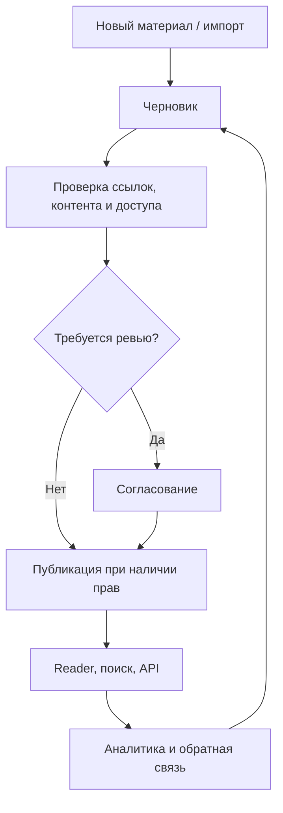

# CajeerEngineBook — обзор продукта

> **Публикуйте знания с контролем над контентом и инфраструктурой.**
>
> CajeerEngineBook объединяет подготовку документации, командное согласование и доставку читателям. Приложение можно размещать на собственной инфраструктуре; доступ к внешним сервисам включается отдельно для соответствующих функций.

[Главная](../../README.md) · [Возможности](features.md) · [Сценарии](workflows.md) · [Архитектура](architecture.md) · [Безопасность](security.md)

---

## Для каких задач

| Сценарий | Как помогает Book |
| --- | --- |
| Публичный портал | Версионированные статьи, навигация, поиск, вложения, читательский интерфейс |
| Внутренняя база знаний | Организации и рабочие пространства, роли и приватные материалы |
| Документация API | OpenAPI, примеры использования, API Playground, SDK |
| Командное авторство | Черновики, история, ревью, контролируемая публикация |
| Миграция документации | Импорт Markdown/MDX-структур с предпросмотром и отчётами об ограничениях |
| Эксплуатация в организации | Аудит, мониторинг, резервные копии, контролируемые обновления |

## Три части продукта

### 01. Studio — рабочее пространство команды

Редактор создаёт черновик, формирует дерево страниц, добавляет изображения и поддерживаемые контентные блоки. Роли ограничивают действия в нужной организации и рабочем пространстве. Изменение может потребовать отдельного согласования перед публикацией.

### 02. Reader — готовая документация

Читатели получают опубликованные страницы с версионной навигацией и поиском. Политика видимости применяется при чтении и поиске. Для документации доступны локализации, статический экспорт и дополнительные интерактивные компоненты.

### 03. Operations — контролируемая эксплуатация

Для администраторов предусмотрены установка, диагностика, наблюдаемость, резервирование и обновления. Система явно разделяет права владельца приложения и привилегии оператора хоста.

## Основной жизненный цикл

## Принципы, которые важно знать заранее

- **Импорт не означает публикацию.** Поддерживаемые импортеры создают черновики; маршруты, права и контент требуется проверить.
- **AI не обязателен.** Семантическое индексирование, чат и предложения редактору требуют отдельной настройки провайдера и политики передачи данных.
- **Self-hosted не означает «без обслуживания».** PostgreSQL, Redis, медиа-тома, ключи, TLS и восстановление имеют требования к инфраструктуре.
- **Тесты не заменяют аттестацию инфраструктуры.** Проверка кода и отдельные лабораторные прогоны не подтверждают готовность конкретной установки.

## Следующий шаг

| Хочу… | Читать |
| --- | --- |
| Сравнить продуктовые функции и ограничения | [Матрица возможностей](features.md) |
| Посмотреть путь автора, редактора и администратора | [Рабочие сценарии](workflows.md) |
| Понять слои приложения и хранение данных | [Архитектура](architecture.md) |
| Выбрать топологию установки | [Развёртывание](deployment.md) |
| Разобраться с RBAC, внешними AI и обновлениями | [Безопасность и данные](security.md) |
| Изучить версии и совместимость | [Центр релизов](../releases/README.md) |
