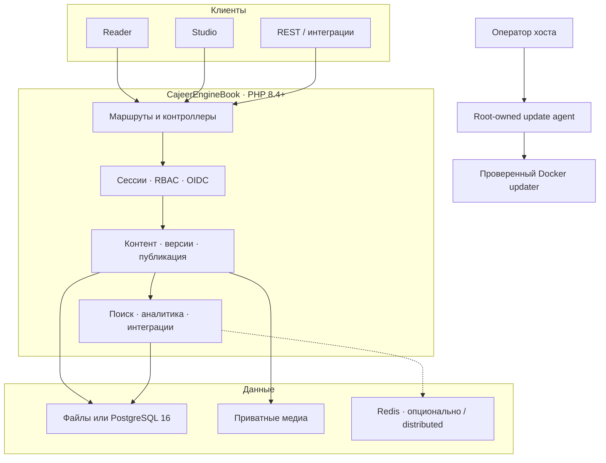
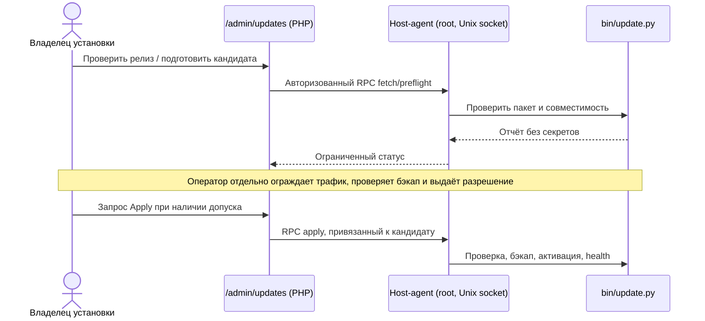

# Архитектура и границы ответственности

[Продукт](README.md) · [Топологии](deployment.md) · [Операционная безопасность](security.md)

## Компоненты системы

### Приложение

Веб-часть реализует Reader, Studio, API и административные маршруты. Контроллеры и сервисы находятся в `src/`, публичный корень — `public/`. Фоновые задачи запускаются отдельным CLI-процессом `bin/worker.php`.

### Встроенное ядро

Папка `core/` содержит **ограниченный набор** классов CajeerEngine `2.1.0`: контейнер сервисов, шаблонизатор и файловые операции обновления. Это **не** интеграция всей CMS CajeerEngine, её БД, панели администратора и миграций. Детали — [embedded engine](../admin/engine-core.md).

### Данные и фоновые задачи

| Режим | Основное состояние | Предназначение |
| --- | --- | --- |
| File | Приватные файлы и медиа | Один узел, упрощённая локальная эксплуатация |
| PostgreSQL | SQL-контент, identity, индекс, аудит + приватные медиа | Производственный SQL-режим |
| Distributed | PostgreSQL + Redis + общее POSIX-медиа | Несколько узлов приложения/воркеров с внешней эксплуатацией отказоустойчивости |

В PostgreSQL-режиме требуется схема **7** и доступный для записи primary. Redis в одноузловой конфигурации необязателен, в документированном распределённом режиме обязателен. Не применяйте transaction-mode pooling там, где нужны session advisory locks.

### Граница привилегий обновления

`PHP` не запускает Docker напрямую и не получает root-доступ к файлам агента. Восстановление, откат и вмешательство при незавершённой миграции выполняются оператором хоста, а не через обычный пользовательский интерфейс.

## Где читать реализацию

- [Конфигурация и секреты](../admin/configuration.md)
- [Эксплуатация и установка](../admin/operations.md)
- [Надёжность распределённой системы](../admin/distributed-reliability.md)
- [Аудит и жизненный цикл ключей](../admin/security-lifecycle.md)
- [Подписанные релизы](../admin/signed-releases.md)
