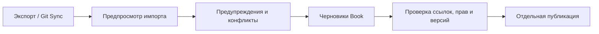

# Рабочие сценарии

[Продукт](README.md) · [Возможности](features.md) · [Развёртывание](deployment.md)

## Сценарий A · Новая публичная документация

| Шаг | Действие | Результат |
| --- | --- | --- |
| 1 | Владелец создаёт организацию и Workspace | Граница владения и настройки видимости |
| 2 | Администратор назначает минимально необходимые роли | Авторы получают нужные права, не права владельца установки |
| 3 | Автор создаёт Book, страницы и версии | Черновое дерево документации |
| 4 | Команда проверяет ссылки, медиа, маршруты и материалы | Контент готов к публикации |
| 5 | Уполномоченный редактор или ревьюер подтверждает изменение | Публикуется согласованный снимок |
| 6 | Команда проверяет документ из анонимной сессии | Reader показывает только разрешённые страницы |

> [!TIP]
> Перед публикацией проверьте публичную и приватную страницы из браузера без авторизации. Доступ к Studio не означает, что страница опубликована.

## Сценарий B · Переезд из другой системы

Путь в интерфейсе: **Studio → Import documentation**. Выберите поддерживаемый формат, изучите предпросмотр и предупреждения, затем подтвердите импорт. Неподдерживаемые динамические MDX/React-компоненты не исполняются. Публичность источника, redirects и конфигурация ролей автоматически не считаются безопасными для переноса.

Руководства: [GitBook](../admin/gitbook-import.md), [Docusaurus](../admin/docusaurus-import.md), [Mintlify](../admin/mintlify-import.md), [ReadMe](../admin/readme-import.md), [Fumadocs](../admin/fumadocs-import.md).

## Сценарий C · Изменение документации с ревью

1. Автор правит черновик, сохраняя опубликованную версию доступной читателям.
2. При политике согласования создаётся запрос на ревью.
3. Ревьюер сверяет содержимое, вложения, версии и целевой маршрут.
4. Уполномоченное лицо публикует изменение.
5. При ошибке команда использует документированную историю редакций и процедуры восстановления, не изменяя данные непосредственно в БД.

## Сценарий D · Обновление установленной платформы

Владелец установки получает сведения о **подписанном** кандидате в `/admin/updates` и инициирует доступные этапы подготовки. Оператор хоста отдельно подтверждает резервную копию и готовность окна обслуживания, останавливает внешние записи, выдаёт краткоживущий разрешительный токен для точного кандидата и контролирует `Apply`.

После обновления проверяются вход владельца и OIDC, Reader, поиск, медиа, воркеры, состояние Redis, история операций и восстановление доступа. **Автоматического `Apply` по расписанию нет.**

См. [изменения 1.2.0](../releases/v1.2.0.md) и [пошаговое операторское руководство](../admin/release-120.md).
