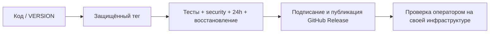

# Релизы CajeerEngineBook

**Один журнал для продуктовых изменений, совместимости и статуса выпуска.**

[Главная](../../README.md) · [Продукт](../product/README.md) · [Процедуры обновления](../admin/secure-updates.md) · [Исходный CHANGELOG](../../CHANGELOG.md)

> [!IMPORTANT]
> Номер в `VERSION`, тег в Git и опубликованный проверенный GitHub Release — разные состояния. **Наличие исходников `1.2.0` не означает**, что завершена защищённая квалификация или доступны подписанные ZIP/OCI-артефакты. Проверяйте официальные [GitHub Releases](https://github.com/CajeerTeam/CajeerEngineBook/releases) и [protected CI](https://github.com/CajeerTeam/CajeerEngineBook/actions) для конкретного commit/tag.

## Навигатор по версиям

| Версия | Продуктовый фокус | Подробности |
| --- | --- | --- |
| **1.2.0** | Заключительная интеграция и усиление безопасных production-обновлений | [Что нового](v1.2.0.md) · [Допуск и rollback](../admin/release-120.md) |
| **1.1.7–1.1.0** | Центр обновлений: обнаружение, подписи, агент, backup, расписание, история | [История ветки 1.1](v1.1.x.md) |
| **1.0.14–1.0.0** | Стабильная платформа, редактор AI, импорт пяти платформ, поиск, аналитика | [История ветки 1.0](v1.0.x.md) |
| **0.9.x и ранее** | Становление функций, безопасности и администрирования | [Полный исторический CHANGELOG](../../CHANGELOG.md) |

## Совместимость текущего исходного дерева

| Параметр | Версия |
| --- | --- |
| Book | `1.2.0` |
| Встроенное ядро | `CajeerEngine 2.1.0` |
| Требуемая PostgreSQL schema | `7` |
| Применение миграции при переходе 1.1.7 → 1.2.0 | **Не требуется**: схема остаётся 7 |

## Как читать статус выпуска

**Защищённый выпуск** требует соответствия результатов CI **тому же commit, run и attempt**, проверенного набора артефактов и подписи. `full_qualification_verified` подтверждает лабораторные условия; `production_certified=false` не является ошибкой — это сознательное обозначение того, что тестовая лаборатория не сертифицирует инфраструктуру заказчика.

## Перед обновлением

1. Проверьте официальный опубликованный подписанный релиз, его commit, схему, ключи и OCI-дигесты.
2. Прочитайте [изменения нужной версии](v1.2.0.md) и [пошаговую операционную процедуру](../admin/release-120.md).
3. Проведите независимый backup/restore drill, согласуйте окно обслуживания и остановку всех записей.
4. После обновления проверьте Reader, Studio, вход владельца, поиск, медиа, воркеры и журнал операций.

Технические подробности прошлых версий сохранены в [CHANGELOG.md](../../CHANGELOG.md); он не подменяет эксплуатационные runbook-файлы и не является доказательством прохождения CI.
