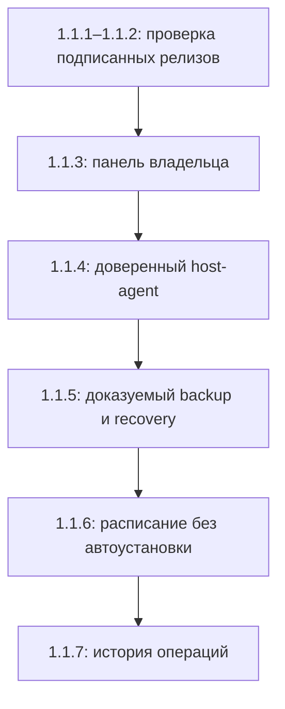

# История выпусков 1.1.x

**От обнаружения нового релиза — к прозрачным, управляемым операциям обновления.**

[Центр релизов](README.md) · [1.2.0](v1.2.0.md) · [Исходный CHANGELOG](../../CHANGELOG.md)

| Выпуск | Изменение | Для пользователя / оператора |
| --- | --- | --- |
| **1.1.7** · История операций | Журнал состояний host-agent и безопасный экспорт диагностики | Видны `queued/running/succeeded/failed`; ошибки и повторные попытки не раскрывают секреты |
| **1.1.6** · Планировщик | Проверки GitHub, уведомления и ограниченная подготовка | Режимы `notify_only`, `download_only`, `manual_approval`; автоматического `Apply` нет |
| **1.1.5** · Backup & Recovery | SHA-256-квитанции бэкапов и дополнительная верификация восстановления | Повреждённый backup блокирует опасное продолжение; recovery/rollback доступны только оператору |
| **1.1.4** · Host-agent | Отдельный root-owned Unix-socket брокер | Веб-процесс не выполняет Docker-команды и не читает приватные host-файлы |
| **1.1.3** · Update Center | Панель владельца `/admin/updates` | Проверка подписанных метаданных без установки приложений из PHP |
| **1.1.2** · Discovery | Поиск подписанных релизов GitHub API | `check --channel stable`, опционально обнаружение beta без установки prerelease |
| **1.1.1** · Release infrastructure | Проверка draft/published ассетов и повторная загрузка для верификации | Неполная публикация или несовпадение SHA-256 не считается успехом |
| **1.1.0** · Acceptance | Единые регрессионные, security, recovery и load gates | Увеличен охват приёмки; локальные тесты не равны production-допуску |

Все перечисленные записи датированы **22.11.2026** в исходном `CHANGELOG.md`. При переходах внутри ветки сохранялись PostgreSQL schema **7** и встроенный CajeerEngine **2.1.0**.

## Как эволюционировала система обновлений

## Операционные границы

- **Не каждый пользователь — владелец установки.** Только владелец имеет доступ к Update Center; операционные операции хоста требуют отдельной авторизации.
- **Обнаружение ≠ установка.** Доступный кандидат ещё не означает проверенную работоспособность в текущей топологии.
- **Обновление ≠ автоматическое восстановление.** При незавершённом `Apply`, миграции или повреждении бэкапа требуется ручной recovery workflow.
- **История ≠ секретные логи.** Экспорт диагностики намеренно исключает токены, содержимое stderr и пути root-owned хранилища.

### Подробные инструкции

[1.1.7 — история](../admin/update-history-117.md) · [1.1.6 — планировщик](../admin/update-scheduler-116.md) · [1.1.5 — backup](../admin/update-recovery-115.md) · [1.1.4 — агент](../admin/update-execution-114.md) · [1.1.3 — UI](../admin/update-center-113.md) · [1.1.2 — discovery](../admin/update-discovery-112.md) · [1.1.1 — release](../admin/release-111.md) · [1.1.0 — acceptance](../admin/release-110.md)
