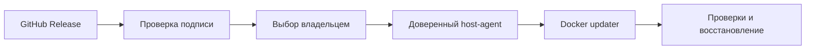

# CajeerEngineBook 1.2.0

**Production Auto Update Release** · по исходному `CHANGELOG.md` от **22.11.2026**

[Все релизы](README.md) · [Подробное руководство оператора](../admin/release-120.md) · [Технический CHANGELOG](../../CHANGELOG.md)

> [!IMPORTANT]
> Это описание **функций, содержащихся в исходниках `1.2.0`**, а не утверждение о доступности подписанного дистрибутива или прохождении production-квалификации. Для установки требуется опубликованный и проверенный GitHub Release того же commit.

## Главное в выпуске

**1.2.0 повышает надёжность уже существующего пути обновлений**, не заменяя установщик и не разрешая безнадзорную активацию:

| Изменение | Польза | Техническая деталь |
| --- | --- | --- |
| Полный отпечаток исходников | Связь результатов квалификации с реальным содержимым релиза | Хэш охватывает отслеживаемые Compose, Dockerfile, PHP, frontend, зависимости, updater, CI и тесты |
| Строгая проверка квалификации | Нельзя выдать частичный прогон за полный | `full_qualification_verified` только после lifecycle + реальной 24-часовой нагрузки |
| Ограниченный вывод процессов | Защита хоста от бесконтрольных логов | `stdout ≤256 KiB`, `stderr ≤1 MiB`; процессная группа завершается при превышении или тайм-ауте |
| Ротация диагностики | Ограниченный объём чувствительных временных данных | Сохраняются восемь последних root-private диагностических заданий; операционная история отдельно |
| Отрицательные тесты | Проверки отказов, а не только успешного пути | Timeout, overflow, ошибки evidence/source fingerprint, subprocess failures |

## Пользовательские изменения

- Владелец видит подписанного кандидата в панели `/admin/updates` и может выполнить разрешённые этапы `Fetch` / `Preflight` / `Apply` через интеграцию с host-agent.
- Операционный журнал сохраняет очищенные состояния выполнения и доступен для диагностики без передачи секретов.
- Параметры запланированных проверок остаются **без автоматического запуска `Apply`**.

## Совместимость и миграции

| Область | 1.2.0 |
| --- | --- |
| PostgreSQL schema | **7**, без новой миграции |
| CajeerEngine Core | **2.1.0**, без изменения |
| Обновление с 1.1.7 | Схема остаётся 7; не запускайте не связанную с релизом миграцию |
| Backup и rollback | Обязательны проверка бэкапа и разрешение оператора; откат только при совместимости записанных данных |

## Условия приёмки

1. Защищённый тег и все обязательные тесты **одного** CI-запуска и попытки.
2. Независимые проверки безопасности, PostgreSQL/Redis, Docker, распределённого режима, PITR и полного восстановления.
3. Отдельный полный **24-часовой** нагрузочный прогон.
4. Подписание релизных артефактов и проверка публично загруженных байтов, SHA-256 и OCI Cosign.
5. Проверка на инфраструктуре конкретного оператора: восстановление, maintenance fencing, health и доступ.

> [!WARNING]
> `production_certified=false` — намеренное значение: успешная квалификация в лаборатории не гарантирует готовность любой production-инсталляции. Не продвигайте релиз без выполнения [операторского runbook](../admin/release-120.md).

## Чтение для оператора

[Допуск 1.2.0](../admin/release-120.md) · [Подписанные релизы](../admin/signed-releases.md) · [Безопасное обновление](../admin/secure-updates.md) · [Восстановление](../admin/update-recovery-115.md)
